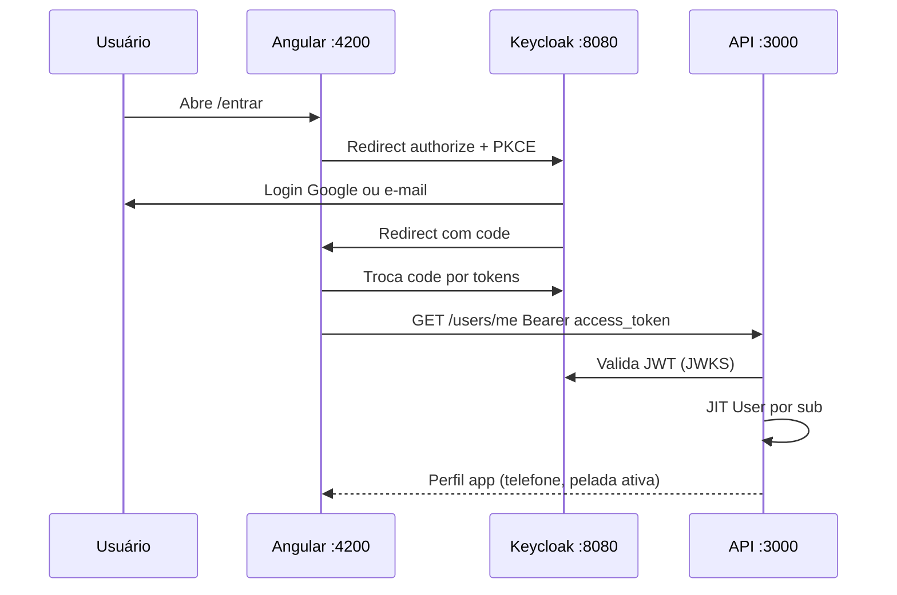

# Ambiente local — URLs, Keycloak e Angular (pré F0-1 / F0-4)

Contrato de portas e OIDC para **dev na sua máquina**. Produção troca hosts por `https://app.`, `https://api.`, `https://auth.` (mesmos nomes de realm e client).

Copie [.env.example](../.env.example) para `.env` na raiz (Compose: `npm run stack:up` ou serviços parciais — ver [desenvolvimento-local.md](desenvolvimento-local.md)).

---

## Mapa de serviços (dev)

| Serviço | URL | Porta | Issue |
|---------|-----|-------|--------|
| Angular (`ng serve`) | http://localhost:4200 | 4200 | F0-1, F0-5 |
| API Nest | http://localhost:3000 | 3000 | F0-1, F0-3 |
| Health | http://localhost:3000/health | — | F0-3 |
| Keycloak | http://localhost:8080 | 8080 | F0-4 |
| Realm | http://localhost:8080/realms/pelada | — | F0-4 |
| Postgres **app** | `localhost:5433` | 5433 | F0-2, F0-7 |
| Postgres **Keycloak** | `localhost:5434` (interno ao compose) | 5434 | F0-7 |
| Protótipo Resenha (referência) | http://127.0.0.1:8000 | 8000 | — (sem auth) |

**Dois bancos:** dados da pelada **nunca** no Postgres do Keycloak.

---

## Client Keycloak `pelada-web` (configurar na F0-4)

| Campo | Valor dev |
|-------|-----------|
| Client type | OpenID Connect |
| Client ID | `pelada-web` |
| Client authentication | **OFF** (público + PKCE) |
| Standard flow | ON |
| Direct access grants | OFF (não usar senha direto na API) |
| Valid redirect URIs | `http://localhost:4200/*` |
| Valid post logout redirect URIs | `http://localhost:4200/` |
| Web origins | `http://localhost:4200` |
| PKCE | S256 (obrigatório para client público) |

### Endpoints OIDC usados pelo Angular

| Uso | URL |
|-----|-----|
| Authorization | `{KEYCLOAK_URL}/realms/pelada/protocol/openid-connect/auth` |
| Token | `.../protocol/openid-connect/token` |
| Logout | `.../protocol/openid-connect/logout` |
| UserInfo (opcional) | `.../protocol/openid-connect/userinfo` |
| JWKS (API) | `.../protocol/openid-connect/certs` |

Variáveis em `.env.example`: `KEYCLOAK_ISSUER`, `KEYCLOAK_JWKS_URI`.

### Google (IdP)

O realm importado (**F0-4**) traz o provider **Google** **desligado** (`enabled: false`). Para testar:

1. [Google Cloud Console](https://console.cloud.google.com/) → OAuth client (Web).
2. Redirect autorizado: `http://localhost:8080/realms/pelada/broker/google/endpoint`
3. Admin Keycloak → Realm **pelada** → Identity providers → **Google** → colar Client ID/Secret → **Save** → **Enable**.

Redirect do Google aponta para o Keycloak, não para o Angular.

---

## Fluxo no app (F0-5 / F0-6)



1. **Angular** guarda `access_token` (memória + storage seguro conforme lib; refresh com `refresh_token` se configurado).
2. **Interceptor** adiciona `Authorization: Bearer …` em chamadas à API.
3. **API** não lê cookie de sessão própria para login — só JWT Keycloak.
4. Sem telefone → `/entrar/completar` → `PATCH /users/me` (ou `/me` conforme implementação F0-4b).

### Rotas Angular (auth)

| Rota | Guard |
|------|--------|
| `/entrar` | Público; inicia OIDC |
| `/entrar/completar` | `authGuard` + falta telefone |
| `/inicio`, `/partida/*`, … | `authGuard` |
| Regras, fechar lista, sortear, caixa adm | `organizadorGuard` |

---

## Variáveis no Angular (após F0-1)

Em `apps/pelada-web`, usar `environment.ts` (ou `import.meta.env`) espelhando a raiz:

```typescript
export const environment = {
  production: false,
  apiUrl: 'http://localhost:3000',
  keycloak: {
    url: 'http://localhost:8080',
    realm: 'pelada',
    clientId: 'pelada-web',
  },
};
```

Biblioteca sugerida: `angular-oauth2-oidc` (PKCE) ou `keycloak-angular`.

---

## Testar login no Angular (F0-5)

1. `npm.cmd run keycloak:up` e `npm.cmd run dev:api` (API com **`DEV_AUTH_BYPASS=false`** para JWT real).
2. `npm.cmd run dev:web` → http://localhost:4200/entrar → **Entrar com Keycloak**.
3. Login `dev@pelada.local` / `dev-pelada-local` (ou Google se IdP ativo).
4. Sem telefone na API → `/entrar/completar`; com telefone → `/inicio` (mostra e-mail logado).

Redirect OIDC: `http://localhost:4200/entrar` (já no client `pelada-web`).

## Modo dev sem Keycloak (temporário)

Com **F0-4b**, a API aceita `DEV_AUTH_BYPASS=true` no `.env` (qualquer `Authorization: Bearer …` vira o `DEV_AUTH_SUB`). Teste rápido:

```powershell
# .env: DEV_AUTH_BYPASS=true
npm.cmd run dev:api
curl -H "Authorization: Bearer teste" http://localhost:3000/me
```

**Desligado** em staging/produção. Com Keycloak no ar e bypass `false`, use o `access_token` real no Bearer.

---

## Staging / produção (referência)

| Dev | Produção |
|-----|----------|
| http://localhost:4200 | https://app.seudominio.com |
| http://localhost:3000 | https://api.seudominio.com |
| http://localhost:8080 | https://auth.seudominio.com |

Cadastrar **as três URLs de produção** no client Keycloak (redirect, logout, web origins). Capacitor (**STORE-1**): incluir scheme/deep link acordado no mesmo client.

---

## O que é automático vs o que é você (F0-4)

| Automático (`npm run keycloak:up`) | Opcional / depois |
|-----------------------------------|-------------------|
| Container Keycloak + Postgres do Keycloak | Sua conta Google no login |
| Realm **pelada**, client **pelada-web** (PKCE) | IdP Google (Admin Console + OAuth Google Cloud) |
| Atributo **phone** no usuário dev (import) | Perfil **phone** no realm: Admin → Realm settings → User profile (1 min) |
| Usuário dev `dev@pelada.local` (só local) | Login no Angular (**F0-5**) |

**Não** é preciso “configurar Keycloak com sua conta” antes do smoke. O `smoke:keycloak` só pergunta se o servidor em `:8080` já está de pé e se o realm responde OIDC.

## Subir Keycloak local (F0-4)

Na raiz do monorepo (`.env` alinhado com `.env.example`):

```powershell
npm.cmd run keycloak:up
# 1ª subida com import: espere 1–4 min antes do smoke
npm.cmd run smoke:keycloak
```

Se o smoke falhar com `fetch failed`:

```powershell
docker ps -a --filter name=pelada-keycloak
docker logs pelada-keycloak --tail 80
```

- **Restarting / erro de DB / smoke `fetch failed`:** senha do Postgres do Keycloak fica **gravada no volume** na 1ª subida. Se mudou `POSTGRES_KEYCLOAK_PASSWORD` no `.env`, o container entra em loop. **Reset:**

```powershell
npm.cmd run keycloak:reset
# aguarde 1–3 min
npm.cmd run smoke:keycloak
```

Volumes têm nome fixo `pelada_pg_keycloak` (antes do fix F0-7 podia ser `app-futebol_pelada_pg_keycloak` — remova com `docker volume ls`).

- **Senha admin / `dev` não funcionam** com Keycloak no ar: quase sempre é volume antigo **sem** reimport do realm — use `keycloak:reset` acima (não adianta repetir senha do doc).
- **Porta 8080:** outro programa usando 8080? Mude `KEYCLOAK_HTTP_PORT` no `.env` e `KEYCLOAK_ISSUER` / URLs no Angular depois.

- Admin: http://localhost:8080 — usuário `KEYCLOAK_ADMIN` / `KEYCLOAK_ADMIN_PASSWORD` (padrão dev: `admin` / `keycloak_admin_dev`).
- Realm **pelada** e client **pelada-web** vêm de `infra/keycloak/import/pelada-realm.json` na **primeira** subida do Postgres do Keycloak.
- Se o realm não aparecer ou logs mostram `Failed to run import`: atualize o repo (`git pull`), `docker compose stop keycloak`, `docker compose up -d keycloak`. Se import falhou várias vezes, apague o volume `pelada_pg_keycloak` e suba de novo.

### Atributo `phone` (após 1º login no Admin)

Realm **pelada** → **Realm settings** → **User profile** → **Create attribute** → Name: `phone`, Display name: Telefone → Save. (O JSON de import do KC 26 não aceita `userProfile` no realm export.)

### Usuário de teste (dev, só local)

| Campo | Valor |
|-------|--------|
| Username | `dev` (ou e-mail `dev@pelada.local`) |
| Senha | `dev-pelada-local` |
| Atributo `phone` | `11999990000` (exemplo no import) |

**Não** usar em produção.

## Checklist F0-4 (smoke manual)

- [ ] `npm.cmd run smoke:keycloak` → `OK Keycloak smoke`
- [ ] Admin console abre em :8080
- [ ] Realm `pelada` e client `pelada-web` com URIs acima
- [ ] Login `dev@pelada.local` / `dev-pelada-local`
- [ ] (Opcional) Google IdP habilitado e testado
- [ ] Token em https://jwt.io mostra `iss` = `KEYCLOAK_ISSUER` e `sub` estável

Issue GitHub: **F0-4**, **F0-4b**, **F0-5**, **F0-6**, **F0-7**.
