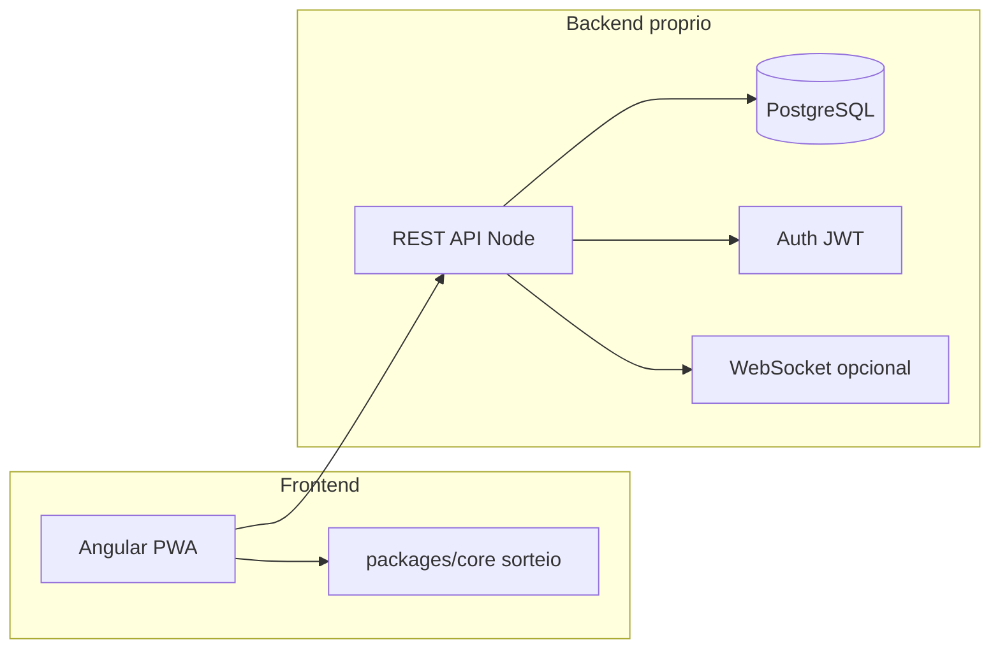
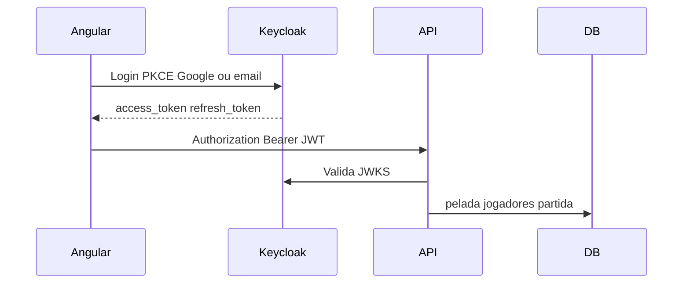
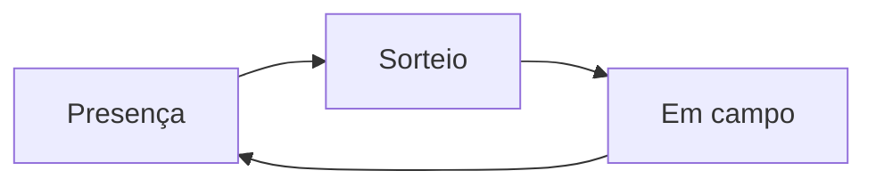
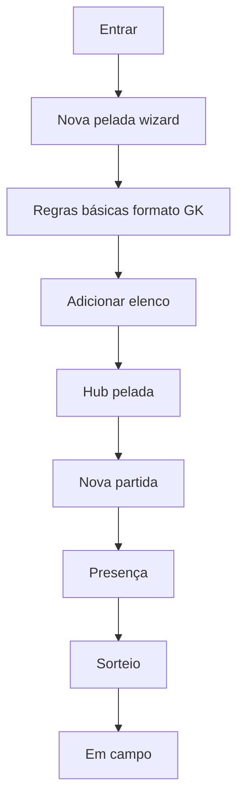

# Arquitetura — backend, frontend e navegação

Complemento ao [historias-de-usuarios.md](../historias-de-usuarios.md). Define **stack**, **módulos do backend**, **rotas/telas** e **fluxos de navegação** alinhados ao MVP.

---

## 1. Visão geral



| Camada | Responsabilidade |
|--------|------------------|
| **Frontend** | Telas, navegação, formulários, sorteio na UI (chama `core`), share WhatsApp |
| **packages/core** | Algoritmo de balanceamento, métricas, sugestão de formato — **sem** React/DB |
| **Backend** | Persistência, auth, permissões (adm/jogador), presença em tempo real, regras da pelada |
| **Link público** | Presença/convidado sem app (histórias 33, 42, 82) — rotas com token |

**Stack (decisão)**

| Peça | Escolha | Motivo |
|------|---------|--------|
| Frontend | **Angular** (standalone, Angular Router) + **PWA** (`@angular/service-worker`) | Stack escolhida; mobile-first 390px |
| UI | Tokens e layout do protótipo **Resenha** → [ui-referencia-resenha.md](ui-referencia-resenha.md) + [prototipo/visual/README.md](../prototipo/visual/README.md); T2 componentes no Angular | Mobile 390px; galeria prevalece sobre wireframes antigos |
| Backend | **API própria** (recomendado **NestJS** + Prisma + PostgreSQL) | Auth, dados compartilhados, sorteio confiável |
| Auth | **Keycloak** (OIDC): Google + e-mail/senha; Angular PKCE; API valida JWT | Ver §1.1 |
| Monorepo | `apps/pelada-web` (Angular) + `apps/api` + `packages/core` + `apps/pelada-mobile` (Capacitor, issue `STORE-1`) | Web é fonte única; lojas empacotam o mesmo build |
| Hospedagem web | Angular estático (Firebase Hosting, Cloudflare Pages, Nginx) + API + Postgres | `DEPLOY-1` |
| Lojas | Google Play (`.aab`) + App Store (`.ipa`) via Capacitor | Ver [publicacao-lojas-play-app-store.md](publicacao-lojas-play-app-store.md) |

### Backend é necessário?

| Cenário | Precisa de API? |
|---------|-----------------|
| **MVP da sua spec** (vários jogadores, presença, convidado, caixa, login Google/e-mail, mesma pelada em mais de um celular) | **Sim** |
| Protótipo só do organizador, um aparelho, dados no `localStorage` | Não (mas não é o produto) |
| Sorteio “de verdade” sem confiar no celular do adm | **Sorteio no servidor** (ou API que persiste o resultado oficial) |

**Resumo:** para o que você descreveu, **backend é necessário**. O Angular é só a interface; **login, banco, regras, presença, sorteio persistido e caixa** ficam na API. O `packages/core` pode rodar no **Node (API)** e, opcionalmente, no **Angular** só para pré-visualizar antes de salvar.

**Alternativa mínima (não recomendada para MVP completo):** Firebase/Supabase como “backend gerenciado” em vez de API Nest — ainda é backend, só que BaaS. Você pediu API própria; mantemos Nest/Fastify.

**Protótipo Resenha (referência de UI)**

| Onde | Como abrir |
|------|------------|
| App interativo | Servir [prototipo/](../prototipo/) (`python3 -m http.server 8000`) → [prototipo/README.md](../prototipo/README.md) |
| Galeria (16 telas × mobile/desktop) | [prototipo/visual/README.md](../prototipo/visual/README.md) |
| Mapa spec ↔ rotas Angular ↔ `#hash` | [ui-referencia-resenha.md](ui-referencia-resenha.md) |
| Rotas de produção | §4.2 abaixo (`/inicio`, `/partida/*`, …) — não confundir com `#inicio` do protótipo |

---

## 1.1 Autenticação com Keycloak (recomendado)

### Opinião resumida

**Vale usar Keycloak** para login (Google + e-mail/senha), tokens OIDC e evolução sem reimplementar auth. O trade-off é **operar** outro serviço (HTTPS, backup, updates). No MVP: **um realm**, Keycloak em **Docker** na VPS ou provedor gerenciado.

A **API Nest não implementa login** — valida o JWT do Keycloak e autoriza por pelada no Postgres.



### Configuração sugerida no Keycloak

| Item | Sugestão |
|------|----------|
| Realm | `pelada` |
| Client `pelada-web` | Público, Standard flow, **PKCE**, redirect do Angular |
| IdP | **Google** (identity broker) |
| Login | E-mail + senha no realm (Google na tela do Keycloak) |
| Atributos | `phone` (custom); foto via `picture` / Google |
| Papéis | Identidade no Keycloak; **organizador/jogador por pelada** no **Postgres da app** |

### Angular

- `angular-oauth2-oidc` ou `keycloak-angular`
- `/entrar` redireciona ao login Keycloak (Google aparece se IdP ativo)
- Sem telefone → `/entrar/completar` → `PATCH /me` na API

### API NestJS

- JWT via JWKS (`nest-keycloak-connect` ou `passport-jwt`)
- `sub` → `User.keycloakSub` (criação JIT no primeiro acesso)
- Rotas: `GET/PATCH /me` — **sem** `/auth/google` na API

### Onde ficam nome, e-mail, telefone, foto

| Dado | Onde |
|------|------|
| E-mail, senha, Google | Keycloak |
| Nome, foto | Keycloak (+ Google) |
| Telefone | Coluna na app **ou** atributo Keycloak (MVP: **app** é mais simples) |
| Pelada, sorteio, caixa | Só Postgres da app |

---

## 1.2 Backend da aplicação e hospedagem

Keycloak **não substitui** a API — só autentica.

| Camada | Stack | Dados |
|--------|-------|--------|
| Auth | Keycloak + Postgres **próprio** | usuários, IdP |
| API | NestJS + Prisma | negócio + autorização |
| App DB | PostgreSQL **separado** | elenco, partidas, draw, caixa |
| UI | Angular estático | — |

**Dois bancos Postgres** (ou dois containers): nunca misturar schema Keycloak com schema da app.

### Hospedagem sugerida (MVP)

**Opção A (recomendada):** 1 VPS (4 GB) + Docker Compose (`keycloak`, `postgres-keycloak`, `postgres-app`, `api`, reverse proxy **Caddy**/Traefik) + Angular em **Cloudflare Pages** + DNS/SSL no Cloudflare (`app.`, `api.`, `auth.`).

**Opção B:** Keycloak na VPS; **Neon/Supabase só como Postgres** da app; API em Railway/Fly.io.

**Opção C:** AWS/Azure — depois do MVP.

Checklist: HTTPS nos três hosts; backup diário dos dois Postgres; CORS só no domínio do Angular.

---

## 2. Modelo de domínio (backend)

Entidades principais e quem altera:

| Entidade | Descrição | Histórias |
|----------|-----------|-----------|
| `User` | Conta app (`keycloakSub`, telefone); identidade no Keycloak | login |
| `Pelada` | Grupo / racha | 1, 8 |
| `PeladaMember` | user + papel (`organizador` \| `jogador`) + perfil na pelada | 11, 12 |
| `PlayerProfile` | Nota, atributos, tags, posição, `isGoalkeeper`, plano pagamento, fixo lista | 14–16, 23–27 |
| `PeladaRules` | Linha/time, modalidade, modos GK, rodízio, regras sorteio, modo presença | 2–10, 33 |
| `Match` | Partida (data, local, regras override) | 9, 32 |
| `MatchAttendance` | confirmado / recusado / fila / convidado pendente | 35–46 |
| `Draw` | Resultado sorteio + score equilíbrio + seed | 47–61 |
| `MatchSession` | Quem em campo, placar, rodada rodízio | 63–70 |
| `PaymentLedger` | Quem pagou período/partida (Pix = marcar pago) | 14–18 |
| `PeladaInvite` | Link/QR entrada no grupo | 11 |

**Permissões**

| Ação | Organizador | Jogador | Link convidado |
|------|-------------|---------|----------------|
| Editar regras pelada | sim | não | não |
| Editar perfil outro jogador | sim | não* | não |
| Editar próprio perfil | sim | se 27 habilitado | não |
| Criar partida / sortear | sim | não | não |
| Confirmar própria presença | sim | sim | convidado limitado |
| Ver times sorteados | sim | sim | opcional token |

---

## 3. Backend — módulos e API

### 3.1 Módulos (pastas lógicas)

```
packages/core/          # sorteio, métricas, suggestFormat()
apps/api/               # API REST própria
  src/modules/
    auth/
    users/
    peladas/
    matches/
    attendance/
    draw/
    payments/
    invites/
apps/pelada-web/          # Angular — HttpClient + interceptors JWT
```

### 3.2 Endpoints / operações (REST JSON)

| Módulo | Operação | Uso na UI |
|--------|----------|-----------|
| **Auth** | *(sem login na API)* — Angular faz OIDC no Keycloak; API valida JWT (`F0-4b`). Opcional: `GET /users/me` (perfil app: telefone, pelada ativa) | entrada / shell |
| **Peladas** | `POST /peladas`, `GET /peladas`, `GET /peladas/:id` | criar, listar |
| **Peladas** | `PATCH /peladas/:id/rules` | config 2–10 |
| **Members** | `POST invite`, `POST join`, `PATCH role`, `DELETE` | 11, 12 |
| **Profiles** | `GET/PATCH /peladas/:id/members/:id/profile` | 23–27 |
| **Matches** | `POST/GET/PATCH /peladas/:id/matches` | 32, 13 |
| **Attendance** | `POST confirm`, `POST decline`, `POST queue`, `POST approve-guest` | 35–43 |
| **Attendance** | `POST close-list` | 38 |
| **Draw** | `POST /matches/:id/draw` body: mode, constraints | 50–55 |
| **Draw** | `PATCH /matches/:id/draw` swap player | 54 |
| **Session** | `POST start-round`, `PATCH score`, `POST rotate` | 63–68 |
| **Payments** | `GET ledger`, `POST mark-paid` (MVP). `POST generate-charge-text` (cobrança Zap/Pix assistida) = **Depois** — hist. 18, issue `3.9-ZAP` | 14–17 MVP |
| **Public** | `GET /p/:token` presença | 33, 82 |

**Realtime (opcional MVP+):** canal `match:{id}:attendance` para lista ao vivo (36).

**Sorteio:** preferir rodar `drawTeams()` no **servidor** (mesma lib `core`) para não confiar só no client; client pode pré-visualizar.

---

## 4. Frontend Angular — rotas e navegação

Alinhado à [Especificação das telas do MVP](../App%20de%20Pelada%20—%20Especificação%20das%20telas%20do%20MVP.md): **4 abas** na shell principal.

### 4.1 Estrutura de módulos (sugestão)

```
apps/pelada-web/src/app/
  core/           # auth guard, interceptors, API services
  shared/         # T2 components, ScreenHeader, bottom-nav
  features/
    auth/
    onboarding/   # criar pelada (L1)
    inicio/       # 3.1, 3.2, 3.3
    partida/      # 3.4, 3.5, 3.6
    jogadores/    # 3.7, 3.8
    caixa/        # 3.9
  layout/
    main-shell/   # router-outlet + bottom nav (T3)
```

### 4.2 Rotas Angular

| Rota | Componente | Aba | Spec |
|------|------------|-----|------|
| `/entrar` | LoginComponent | — | Auth |
| `/entrar/completar` | CompletarPerfilComponent | — | telefone/foto |
| `/onboarding/pelada` | CriarPeladaComponent | — | L1 · hist. 1 |
| `/inicio` | InicioComponent | Início | §3.1 |
| `/inicio/regras` | RegrasPeladaComponent | Início | §3.2 |
| `/inicio/criar-partida` | CriarPartidaComponent | Início | §3.3 |
| `/partida/presenca` | PresencaComponent | Partida | §3.4 |
| `/partida/sorteio` | SorteioComponent | Partida | §3.5 |
| `/partida/campo` | EmCampoComponent | Partida | §3.6 |
| `/jogadores` | JogadoresListaComponent | Jogadores | §3.7 |
| `/jogadores/:id` | JogadorPerfilComponent | Jogadores | §3.8 |
| `/caixa` | CaixaComponent | Caixa | §3.9 |

**Partida ativa:** `MatchContextService` (ou store) com `currentMatchId` — aba Partida usa sempre a partida em andamento.

**Guards:** `authGuard` em `/inicio`…; `organizadorGuard` em regras, fechar lista, sortear, caixa.

### 4.3 Bottom navigation (T3)

| Aba | `routerLink` default |
|-----|----------------------|
| Início | `/inicio` |
| Partida | `/partida/presenca` (ou última subrota visitada) |
| Jogadores | `/jogadores` |
| Caixa | `/caixa` |

### 4.4 Fluxo dentro da aba Partida

Fluxo natural do dia do jogo:



| Etapa | Tela | Bloqueio |
|-------|------|----------|
| 1 Presença | confirmados, fila, convidados, fechar lista | sorteio exige lista fechada (configurável) |
| 2 Sorteio | equilibrado/aleatório, métricas, share | jogo pode exigir sorteio feito |
| 3 Em campo | dupla em campo, placar, rodízio GK | — |

**Header da partida:** data, local, badge “lista aberta/fechada”, botão compartilhar.

---

## 5. Fluxos de navegação (jornadas)

### 5.1 Organizador — primeira vez



### 5.2 Jogador — dia da pelada

1. `/entrar` → shell com abas (pelada ativa no contexto)  
2. `/partida/presenca` → confirma “vou” (modo configurado na pelada)  
3. `/partida/sorteio` → vê times (leitura se não for organizador)  
4. `/partida/campo` → placar e quem está em campo  

### 5.3 Convidado — link sem conta completa

1. Abre `/c/[token]`  
2. Identifica nome ou pede entrada (42)  
3. Organizador aprova em presença (43)  
4. Entra no sorteio se confirmado  

### 5.4 Deep links úteis

| Link | Comportamento |
|------|----------------|
| `/c/[invite]` | Entrar na pelada |
| `/c/[matchToken]/presenca` | Só presença da partida |
| `/partida/sorteio` (com `matchId` no contexto ou query) | Abrir sorteio da partida ativa — **não** usar rotas legado `/app/...` |

---

## 6. Telas — componentes principais (frontend)

| Tela | Componentes-chave |
|------|-------------------|
| Wizard pelada | steps: identidade → formato (2–3) → GK (5–7) → presença default (33) |
| Config | seções colapsáveis: Pelada \| Sorteio \| Pagamento \| Presença |
| Elenco | lista + busca; card jogador: nota, tags, GK, plano pagamento, fixo |
| Presença | colunas: confirmado / não respondeu / fila / convidado; CTA fechar lista |
| Sorteio | colunas por time; média; score ⚖️; ações regerar, arrastar, share |
| Em campo | seletor A×B; card descanso; placar; timer; GK lado (65) |
| Share | modal: texto WhatsApp, imagem times, ocultar níveis |

**Estado local:** rascunho de sorteio antes de “publicar” para o grupo (53).

---

## 7. O que entra no MVP vs depois

Detalhamento dos **quatro eixos** fora do MVP imediato (convite grupo, WAF/rate limit, CI-1, Pix 18) e alternativas no MVP: [escopo-seguranca-fora-mvp.md](escopo-seguranca-fora-mvp.md). Ambiente local Keycloak: [ambiente-dev-auth.md](ambiente-dev-auth.md) · [.env.example](../.env.example).

| Área | MVP | Depois |
|------|-----|--------|
| Auth | **Keycloak** — Google + e-mail/senha; PKCE no Angular | — |
| Rotas | §4.2 (`/inicio`, `/partida/*`, `/jogadores`, `/caixa`) | deep links extras (34, 82) |
| Backend | CRUD pelada, partida, presença, draw persistido | WebSocket realtime, bot Zap, voz |
| Convidado / links | **MVP:** aprovar convidado na presença (42–43), token de partida se necessário | **Depois:** convite link/QR para **entrar no grupo** (11), link público amplo (33), link pessoal recorrente (34) |
| Caixa / Pix | marcar pago, ledger 14–17 | cobrança Zap/Pix assistida ou automática (18) |
| Infra segurança | HTTPS, CORS, JWT, validação entrada | rate limit/WAF fino, CI obrigatório (CI-1) |
| Offline / PWA | mobile-first (T6); PWA opcional pós-MVP | 83 offline; service worker dedicado |
| Testes | **local** (`test:core`, `test:api`) | CI GitHub (`CI-1`) |

---

## 8. Ordem de implementação sugerida

Ver [plano-issues-fases-milestones.md](plano-issues-fases-milestones.md) (F0–F7). Resumo:

1. F0 — monorepo, harness de testes local, Docker, Keycloak, API skeleton  
2. T1–T6 + telas M1–M2  
3. CORE + sorteio + presença  
4. Campo + caixa (14–17; **sem** cobrança Zap — hist. 18 Depois)  
5. E2E local + deploy staging (`DEPLOY-1`) quando quiser ambiente na internet  

---

## 9. Referência cruzada MVP (histórias)

| MVP histórias | Rotas (spec §4.2) |
|---------------|-------------------|
| 1–10 | `/onboarding/pelada`, `/inicio/regras` |
| 23–27 | `/jogadores`, `/jogadores/:id` |
| 32–38, 42–45 | `/inicio/criar-partida`, `/partida/presenca` |
| 47–61 | `/partida/sorteio` |
| 63–66 | `/partida/campo` |
| 14–17 | `/caixa` |
