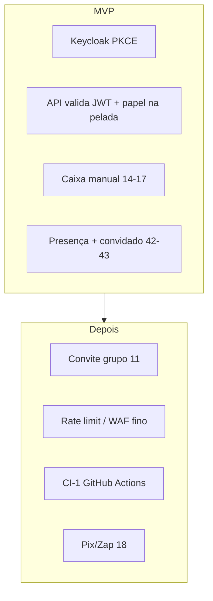

# Segurança e produto — o que fica **fora** do MVP (e o que fazemos no lugar)

Alinhado à coluna **Validação** em [historias-de-usuarios.md](../historias-de-usuarios.md) (`depois` = 43 histórias) e à tabela §7 em [arquitetura-backend-frontend.md](arquitetura-backend-frontend.md).

Objetivo: não implementar “meio caminho” desses itens no MVP e não confundir com o que **já está ok** no escopo.

---

## 1. Convite link/QR para entrar no **grupo** (hist. 11)

| | |
|--|--|
| **Fora do MVP** | Link ou QR para **novo jogador entrar na pelada** (membro do grupo) sem adm cadastrar manualmente. |
| **No MVP** | Organizador cria pelada e cadastra elenco (**L1**, **3.7**). Convidado na **partida**: pedir vaga + adm aprova (**42–43**, telas presença **3.4**). |
| **Segurança** | Sem endpoint público anônimo de “join group” no MVP → menos superfície (sem token de grupo vazando em grupo de WhatsApp). |
| **Depois** | Issue épico backlog; rotas `/c/[invite]` para grupo (spec §6). |

**Não confundir:** presença de convidado **na partida** (MVP) ≠ convite para **entrar na pelada** (Depois).

---

## 2. Rate limiting, WAF e proteção DDoS “de provedor”

| | |
|--|--|
| **Fora do MVP** | Rate limit por IP/usuário na API, regras WAF custom, bot management dedicado. |
| **No MVP** | HTTPS (deploy), CORS restrito ao domínio do Angular (**F0-3**), JWT obrigatório nas rotas privadas (**F0-4b**), validação de entrada (class-validator), Postgres com credenciais fortes. Opcional: limites básicos no **reverse proxy** (Caddy/Cloudflare) no **DEPLOY-1** sem issue separada. |
| **Depois** | `@nestjs/throttler`, Cloudflare WAF, alertas — quando houver tráfego real. |

---

## 3. CI de segurança / qualidade automática no GitHub (**CI-1**)

| | |
|--|--|
| **Fora do MVP imediato** | Workflow que roda em todo PR e bloqueia merge (label **`depois`** na issue **CI-1**). |
| **No MVP** | [processo-testes-e-qualidade.md](processo-testes-e-qualidade.md): **você** e o agente rodam `npm.cmd run test:core` / `test:api` / `test:web` **na sua máquina** antes de fechar cada issue. |
| **Risco aceito** | Sem gate automático no GitHub até ligar CI-1; mitigado por DoD nas issues e testes por camada. |

---

## 4. Pix / cobrança automática no WhatsApp (hist. 18)

| | |
|--|--|
| **Fora do MVP** | Gerar cobrança Zap com Pix integrado, QR dinâmico, gateway de pagamento. |
| **No MVP** | Caixa manual: quem pagou / devendo (**14–17**, **3.9**), `POST mark-paid`, totais no período. Botão Zap **desabilitado ou oculto** (**3.9-ZAP**). |
| **Segurança** | Sem chave Pix nem fluxo de pagamento na API no MVP → sem PCI/gateway no escopo inicial. |
| **Depois** | Hist. 18 + `generate-charge-text` / integrações quando priorizado. |

---

## Resumo visual

---

## Outros itens “depois” com impacto em segurança (não são os 4 acima, mas úteis)

| Hist. / tema | MVP | Depois |
|--------------|-----|--------|
| 33 link público presença amplo | Modos de presença configuráveis; sem página pública anônima completa | Link público amplo |
| 34 link pessoal por jogador | — | Depois |
| 82 web sem instalar app | PWA/navegador com login Keycloak | Otimização “só link” |
| 83 offline | Mobile-first; sem service worker offline | Sync offline |

---

## Onde isso entra nas issues

| Tema | Issues |
|------|--------|
| Auth MVP | F0-4, F0-4b, F0-5, F0-6, F0-7 |
| Caixa sem Pix | 3.9, 3.9-API, 3.9-ZAP |
| Convidado partida | 3.4, 3.4-API |
| CI | CI-1 (depois) |
| Convite grupo | Backlog pós-MVP (hist. 11) |

Atualizar este doc se a **Validação** de uma história mudar de `depois` para `ok`.
