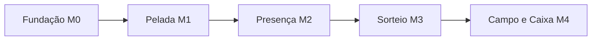
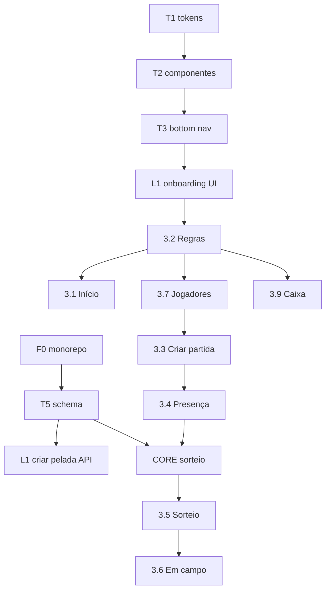

# Plano de desenvolvimento — issues, fases e milestones

Base: [App de Pelada — Especificação das telas do MVP.md](../App%20de%20Pelada%20—%20Especificação%20das%20telas%20do%20MVP.md) · [historias-de-usuarios.md](../historias-de-usuarios.md) · [arquitetura-backend-frontend.md](arquitetura-backend-frontend.md)

**Legenda de labels sugeridas:** `mvp` · `frontend` · `backend` · `core` · `design` · `blocked-by:#id`

---

## Milestones (entregas de produto)

| Milestone | Nome | Objetivo | Critério de “pronto” |
|-----------|------|----------|----------------------|
| **M0** | Fundação | Repo, auth, design system, navegação 4 abas, API + DB | Usuário entra, vê shell do app com abas vazias |
| **M1** | Pelada configurada | Criar pelada, regras, início, elenco | Adm configura grupo, cadastra jogadores, vê card no Início |
| **M2** | Partida e presença | Criar partida → presença → fechar lista | Fluxo até lista fechada com confirmados/fila/convidado |
| **M3** | Sorteio justo | Core + tela sorteio + share | Times equilibrados, arrastar, regerar, compartilhar |
| **M4** | MVP completo | Em campo + caixa + polish | Fluxo ponta a ponta: partida → campo → marcar pago → resumo no Início |



**Nota:** o **sorteio (`packages/core`)** deve começar em paralelo no fim de M1 (spike/protótipo), mesmo que a tela só entre em M3 — conforme sua spec §5.

---

## Fases (ordem de execução)

| Fase | Conteúdo | Milestone | Duração relativa |
|------|----------|-----------|------------------|
| **F0** | Monorepo, CI, Postgres, API skeleton, Auth Google/e-mail | M0 | 1 sprint |
| **F1** | T1–T6 (tema, componentes, nav 4 abas, header, modelo dados, mobile UX) | M0 | 1 sprint |
| **F2** | Onboarding criar pelada + Regras + Início | M1 | 1 sprint |
| **F3** | Jogadores + Perfil (+ lacuna 27 nas Regras) | M1 | 1 sprint |
| **F4** | Criar partida + Presença (+ lacuna 45) | M2 | 1 sprint |
| **F5** | Core sorteio + API draw + Tela Sorteio | M3 | 1–2 sprints |
| **F6** | Em campo + Caixa + integração resumo Início | M4 | 1 sprint |
| **F7** | Hardening: testes e2e fluxo principal, bugs, deploy staging | M4 | 0,5 sprint |

---

## Mapa: telas ↔ rotas (Angular)

Ver detalhes em [arquitetura-backend-frontend.md](arquitetura-backend-frontend.md) §4.

| Aba | Tela spec | Rota |
|-----|-----------|------|
| Início | Início | `/inicio` |
| Início | Regras | `/inicio/regras` |
| Início | Criar partida | `/inicio/criar-partida` |
| Partida | Presença / Sorteio / Campo | `/partida/presenca` … |
| Jogadores | Lista / Perfil | `/jogadores`, `/jogadores/:id` |
| Caixa | Caixa | `/caixa` |
| — | Criar pelada | `/onboarding/pelada` |
| — | Login | `/entrar` |

**Estado da partida ativa:** contexto global (ou query `?matchId=`) ligando aba Partida à partida em andamento.

---

## Issues — F0 Fundação (infra + auth)

| ID | Título | Tipo | Depende | Histórias |
|----|--------|------|---------|-----------|
| **F0-1** | Monorepo: `apps/pelada-web` (Angular), `apps/api`, `packages/core`, scripts dev | backend | — | — |
| **F0-2** | PostgreSQL + Prisma schema inicial + migrations | backend | F0-1 | T5 |
| **F0-3** | API: health, CORS, validação, tratamento de erro padrão | backend | F0-1 | — |
| **F0-4** | Keycloak: realm `pelada`, client web PKCE, IdP Google, atributo phone | devops | — | §1.1 |
| **F0-4b** | API: validação JWT (JWKS), JIT `User` por `sub`, sem rotas `/auth/*` | backend | F0-2, F0-4 | §1.1 |
| **F0-5** | Angular: OIDC (keycloak-angular ou oauth2-oidc) + `/entrar` + completar telefone | frontend | F0-4 | — |
| **F0-6** | `HttpClient` + interceptor Bearer + `authGuard` / `organizadorGuard` | frontend | F0-4b, F0-5 | — |
| **F0-7** | Docker Compose: keycloak + postgres (×2) + api — doc deploy Opção A | devops | F0-4, F0-1 | §1.2 |
| **CI-1** | *(Depois / opcional)* GitHub Actions em PR | devops | F0-1, LOCAL-DEV-1 | [estrategia-testes.md](estrategia-testes.md) |
| **LOCAL-DEV-1** | Doc + scripts: testes locais, Docker, PowerShell, `.env.example` | docs | F0-1 | [desenvolvimento-local.md](desenvolvimento-local.md) |
| **TEST-API-HARNESS** | Harness API: Postgres teste, factories, mock JWT, 1º teste integração | backend | F0-2, F0-3 | [estrategia-testes.md](estrategia-testes.md) §B |
| **TEST-WEB-HARNESS** | Harness Angular: runner + testes exemplo (guard/interceptor) | frontend | F0-1 | [estrategia-testes.md](estrategia-testes.md) §C |
| **STORAGE-1** | Upload foto pelada/jogador (MVP: disco local ou pasta `uploads/` + URL na API) | backend | F0-1, T5 | L1-API |

**Aceite M0 parcial:** login Google ou e-mail → completar telefone se faltar → redireciona para shell. **Testes locais** (`test:core` / `test:api`) antes de fechar issues F0.

---

## Issues — F1 Base UI (T1–T6)

| ID | Título | Tipo | Depende | Ref spec |
|----|--------|------|---------|----------|
| **T1** | Tema e design tokens (verde-escuro, limão, Inter + título condensado) | design | F0-1 | §2 T1 |
| **T2** | Componentes base (Card, Chip, Avatar, Progress, Switch, Segment, Input, Botões 44px) | frontend | T1 | §2 T2 |
| **T3** | Bottom nav 4 abas (Início, Partida, Jogadores, Caixa) + rotas placeholder | frontend | T2 | §1, §2 T3 |
| **T4** | ScreenHeader (rótulo, título, ação direita) | frontend | T2 | §2 T4 |
| **T5** | Modelo de dados Prisma + DTOs: Pelada, Jogador, Partida, Presença, Time, Pagamento, Regras | backend | F0-2 | §2 T5 |
| **T6** | Layout mobile 390px, touch targets, checklist história 84 | frontend | T3 | §2 T6 |

---

## Issues — F2 Pelada e Início (M1)

| ID | Título | Tipo | Depende | Histórias / spec |
|----|--------|------|---------|------------------|
| **L1** | **Lacuna:** Tela onboarding Criar pelada (nome, foto, dia habitual, local padrão) | frontend | T3, F0-6 | 1 · §4 |
| **L1-API** | `POST /peladas` + upload foto + usuário como organizador | backend | T5, F0-4 | 1 |
| **3.2** | Tela Regras da pelada (seções formato, GK, presença/pagamento, sorteio) | frontend | T2, T4, L1 | 2–10, 16 · §3.2 |
| **3.2-API** | `GET/PATCH /peladas/:id/rules` + validação GK mutuamente exclusivo | backend | T5 | §3.2 regras |
| **3.2-EXC** | Regras exceção por partida (`Match.rulesOverride`) | backend | 3.2-API | 9 |
| **L27** | **Lacuna:** Interruptor “jogador edita próprio perfil” em Regras | frontend | 3.2 | 27 · §4 |
| **3.1** | Tela Início (card próxima partida, atalhos, resumo caixa %) | frontend | T2, T3, T4 | 1, 8, 32 · §3.1 |
| **3.1-API** | `GET /peladas/:id/dashboard` (próxima partida, vagas, caixa mês) | backend | T5 | §3.1 |
| **3.1-EMPTY** | Estados vazios: sem partida / sem jogadores | frontend | 3.1 | §3.1 estados |

**Aceite M1 (pelada):** criar pelada → salvar regras → Início mostra dados reais ou empty states.

---

## Issues — F3 Elenco (M1)

| ID | Título | Tipo | Depende | Histórias / spec |
|----|--------|------|---------|------------------|
| **3.7** | Tela Jogadores (busca, segmento Todos/GK/Linha, lista, + adicionar) | frontend | T3, T2 | 23, 24, 26, 44 · §3.7 |
| **3.7-API** | CRUD jogadores do elenco + `isFixedList` condicional à regra 16 | backend | T5, 3.2-API | 23–26, 44 |
| **3.8** | Tela Perfil do jogador (tags, barras atributos, plano pagamento) | frontend | 3.7 | 23, 24, 26, 27 · §3.8 |
| **3.8-EDIT** | Modo edição adm + ocultar editar se regra 27 desligada | frontend | 3.8, L27 | 27 · §3.8 |

**Aceite:** nota/atributos salvos refletem na lista e alimentam API de sorteio (contrato definido).

---

## Issues — F4 Partida e presença (M2)

| ID | Título | Tipo | Depende | Histórias / spec |
|----|--------|------|---------|------------------|
| **3.3** | Tela Criar partida (data, hora, local, obs, modo presença, regras padrão) | frontend | T2, 3.2 | 32, 33 · §3.3 |
| **3.3-API** | `POST /peladas/:id/matches` + snapshot regras | backend | 3.2-EXC | 32, 33 |
| **3.4** | Tela Presença (resumo vagas, segmentos, lista, convidado, fechar lista) | frontend | T3, T2 | 33, 35–38, 42–44 · §3.4 |
| **3.4-API** | Presença: confirmar/recusar, fila, convidado approve/deny, close list | backend | T5 | §3.4 |
| **L45** | **Lacuna:** Modal sugestão formato quando confirmados ≠ capacidade ideal | frontend | 3.4 | 45 · §4 |
| **L45-CORE** | `suggestFormat(playerCount, rules)` em `packages/core` | core | T5 | 45 |
| **3.4-NAV** | Fechar lista → navegar para Sorteio (aba Partida) | frontend | 3.4 | §1 fluxo |

**Aceite M2:** criar partida → presença atualiza contadores → fechar → sorteio habilitado com elenco confirmado.

---

## Issues — F5 Sorteio (M3) — risco técnico

| ID | Título | Tipo | Depende | Histórias / spec |
|----|--------|------|---------|------------------|
| **CORE-1** | `drawTeams(input)` equilibrado + aleatório + métricas (%, médias) | core | T5 | 47–55, 56–58 |
| **CORE-2** | GK por time vs GK fixo + pesos nota/atributos/tags/posição | core | CORE-1 | 10, 5–7 |
| **CORE-3** | Regerar, fixar time, swap manual (recalcular score) | core | CORE-1 | 53, 54 |
| **CORE-TEST** | Testes: 21/3×6, GK modes, fila parcial | core | CORE-2 | — |
| **5-API** | `POST /matches/:id/draw`, `PATCH` swaps, persistir `Draw` | backend | CORE-1, 3.4-API | 50–54 |
| **3.5** | Tela Sorteio (card equilíbrio, cards por time, drag-and-drop) | frontend | T2, 5-API | §3.5 |
| **3.5-SHARE** | Compartilhar texto/imagem + ocultar notas | frontend | 3.5 | 61 · §3.5 |
| **5-SPIKE** | *(opcional início F2)* Spike UI drag + mock `core` local | frontend | CORE-1 | §5 ordem |

**Aceite M3:** sortear → médias visíveis → arrastar recalcula → share sem notas opcional → GK rules OK.

---

## Issues — F6 Em campo + Caixa (M4)

| ID | Título | Tipo | Depende | Histórias / spec |
|----|--------|------|---------|------------------|
| **3.6** | Tela Em campo (placar, cronômetro, descanso, +1 gol, encerrar) | frontend | T3, 5-API | 63–66 · §3.6 |
| **3.6-API** | Sessão: timer state, score, `POST end-round` rodízio | backend | T5, 3.2-API | 64, 65 |
| **3.6-TIMER** | Cronômetro correto com app em background (Page Visibility) | frontend | 3.6 | §3.6 aceite |
| **3.9** | Tela Caixa (recebido, segmento jogador/partida, pago/devendo, marcar pago) | frontend | T3, T2 | 14, 15, 17 · §3.9 |
| **3.9-API** | Ledger pagamentos + plano jogador + totais período | backend | 3.7-API, 3.2-API | 14–17 |
| **3.9-ZAP** | Botão “Cobrança Zap” desabilitado ou hidden (pós-MVP) | frontend | 3.9 | 18 · §3.9 |
| **3.1-SYNC** | Resumo caixa no Início atualiza ao marcar pago | frontend | 3.1, 3.9 | §3.9 aceite |

**Aceite M4 (MVP):** fluxo completo §1 + caixa coerente com modelo de pagamento.

---

## Issues — F7 Hardening e release

| ID | Título | Tipo | Depende |
|----|--------|------|---------|
| **E2E-1** | E2E Playwright: fluxo MVP + 2 smoke (ver [estrategia-testes.md](estrategia-testes.md) §D) | qa | M4 |
| **DEPLOY-1** | Deploy staging API + web + env secrets | devops | F0 |
| **STORE-1** | Capacitor (`apps/pelada-mobile`), AAB Play Console, IPA App Store Connect — ver [publicacao-lojas-play-app-store.md](publicacao-lojas-play-app-store.md) | devops | DEPLOY-1, F0-5 |
| **DOC-1** | README desenvolvimento + `.env.example` | docs | F0-1 |
| **A11Y-1** | Revisão contraste tokens T1 e foco em formulários | frontend | T1 |

---

## Backlog pós-MVP (não criar issue agora — épico “Depois”)

Conforme spec §6: convite link/QR (11), multi-adm (12), partidas recorrentes (13), cobrança Zap+Pix (18), caixa entradas/saídas (20), fila auto (39), notificações (40), link público presença, gols/voz (67), rankings (71–72), offline (83), WhatsApp bot (79).

---

## Dependências críticas (grafo resumido)



---

## Sugestão de sprints (2 semanas cada)

| Sprint | Meta | Issues principais |
|--------|------|-------------------|
| **S1** | M0 | F0-1…F0-7, LOCAL-DEV-1, TEST-API-HARNESS, TEST-WEB-HARNESS, T1, T2, T3, T4, T6 |
| **S2** | M1 início | T5, L1, L1-API, 3.2, 3.2-API, L27 |
| **S3** | M1 fim | 3.1, 3.1-API, 3.7, 3.7-API, 3.8, CORE-1 spike |
| **S4** | M2 | 3.3, 3.3-API, 3.4, 3.4-API, L45, L45-CORE |
| **S5** | M3 | CORE-2, CORE-3, CORE-TEST, 5-API, 3.5, 3.5-SHARE |
| **S6** | M4 | 3.6, 3.6-API, 3.9, 3.9-API, 3.1-SYNC, E2E-1, DEPLOY-1 |

---

## Template de issue (copiar no GitHub)

Ver também [estrategia-testes.md](estrategia-testes.md) (anexo: blocos por tipo) e [processo-testes-e-qualidade.md](processo-testes-e-qualidade.md) (quem roda testes: você + agente por issue).

```markdown
## Contexto
Tela: §3.X — [nome]  _(ou F0 / CORE / CI — se não for tela)_
Histórias: [IDs]
Milestone: M?
Issue plano: [ID ex. 3.4-API]

## Escopo
- [ ] ...

## Fora de escopo
- ...

## Critérios de aceite
(copiar checkboxes da spec §3 ou critérios da issue no plano)

## API / Core
- Endpoints: ...
- packages/core: ...

## Design
Tokens T1, componentes T2, header T4

## Testes obrigatórios (não fechar issue sem isso)
_Marcar no PR quais itens foram feitos. Testes **locais** (`desenvolvimento-local.md`). CI (`CI-1`) opcional depois._

### Se issue `core` (CORE-*, L45-CORE)
- [ ] Novos casos Vitest em `packages/core` (meta: ver §A do doc)
- [ ] `npm run test:core` verde local e no CI

### Se issue `backend` (*-API, F0-2…F0-4b, F0-3, T5)
- [ ] Testes integração Supertest + Postgres teste (`TEST-API-HARNESS`)
- [ ] Casos mínimos do módulo (ver §B do doc — linha desta issue)
- [ ] `npm run test:api` verde local e no CI
- [ ] Migration Prisma se schema mudou

### Se issue `frontend` (3.x, L*, T*, F0-5, F0-6)
- [ ] Se há lógica (guard, form, chamada API): testes unitários (`TEST-WEB-HARNESS`)
- [ ] Se só layout: checklist spec + **screenshot** no PR (até E2E-1)
- [ ] Critérios de aceite da tela §3 testados manualmente

### Se issue `qa` (E2E-1)
- [ ] Playwright: fluxo MVP §D + 2 smoke
- [ ] Roda contra staging (`DEPLOY-1`)

### Se issue `devops` (CI-1, DEPLOY-1, F0-7)
- [ ] CI-1: workflow bloqueia merge se testes falharem
- [ ] DEPLOY-1: env documentados; smoke pós-deploy

## Processo de execução dos testes
- [ ] **Você** roda `npm.cmd run test:*` relevantes **na sua máquina** antes de fechar a issue
- [ ] **Agente Cursor** (se usado na implementação) roda os mesmos comandos no seu PC até verde — **só escopo desta issue**
- [ ] Sem CI obrigatório até `CI-1` (depois)
- [ ] Detalhes: [processo-testes-e-qualidade.md](processo-testes-e-qualidade.md)

## Definition of Done
- [ ] Aceite spec/plano
- [ ] Testes acima (local)
- [ ] PR/commit referencia a issue
```

---

## Checklist de alinhamento com sua spec

| Item spec | Coberto por issue |
|-----------|-------------------|
| 4 abas + fluxos §1 | T3, rotas § mapa |
| T1–T6 §2 | T1–T6 |
| Telas 3.1–3.9 | 3.1 … 3.9 + APIs |
| Lacunas §4 | L1, L27, L45 (+ L45-CORE) |
| Ordem §5 | Fases F0–F7 |
| Fora MVP §6 | Backlog pós-MVP |
| Cobrança Zap desabilitada MVP | 3.9-ZAP |
